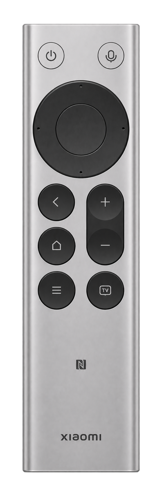

# 小米蓝牙遥控器 2 Pro

| 位置 | RemoteDesk 默认动作 |
| --- | --- |
| 顶部左侧电源键 | 短按切换屏幕，长按锁屏 |
| 顶部右侧语音键 | 向 ChatGPT 发送听写键 F5 |
| 方向环、中央圆键 | 方向键、确认 |
| 返回、主页 | 返回、激活 ChatGPT |
| 音量摇杆 | 音量加减 |
| 底部菜单、直播键 | 打开运行中应用选择器、打开媒体选择器 |

## 配对和检查

1. 在 Mac 的「系统设置 → 蓝牙」中配对遥控器，再打开 RemoteDesk。
2. 如果显示「已连接 · 未监听」，在「隐私与安全性 → 输入监控」中授权 RemoteDesk。模拟快捷键还需要「辅助功能」权限。
3. 在工作台打开「显示设备说明」并点击机身引线定位按键配置。如果某个键无法识别，可用「信号诊断」检查按下和松开事件，再到工作台校准。
4. 如果语音键有反应但无法听写，检查 ChatGPT 的听写快捷键是否为 F5。RemoteDesk 当前未采集遥控器的麦克风音频。

机身下半部的 NFC 标记用于兼容设备的原厂碰一碰投屏。RemoteDesk 当前未接入该标签。
